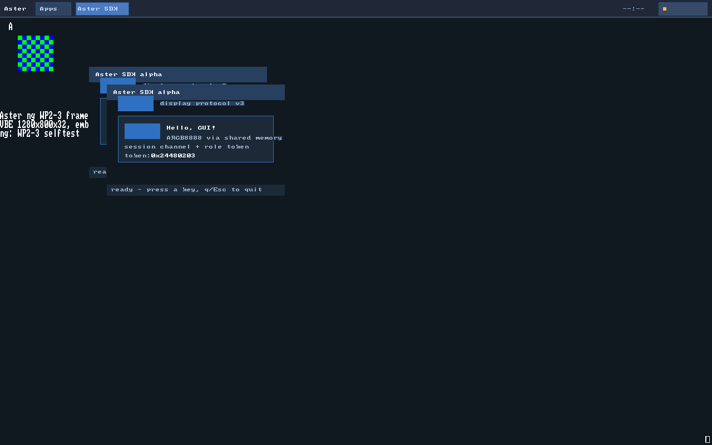

# ng-WP3-4：SDK v3 收口 + 会话通道 + GUI demo（PASS）

## 结论

**PASS** —— E3 / WP3-4 出口达成：Aster SDK 从 alpha 骨架升级到 **display 协议
v3 + session 通道**，`sdk/examples/hello_gui` 在 QEMU 里由真实的
**init → sessiond → WM LAUNCH → sessiond spawn** 链拉起，拿到 sessiond 经
argv 签发的 role_token，创建 v3 窗口、被 WM 任务表看见，并在同一轮内核自检
里走完注册/心跳/回收/清理（`ng: WP3-3 selftest PASS`）。

- **协议 v3**：`display.h` 发送 version 3（CREATE body 44 带 token、FOCUS
  第二字=token、LIST_REPLY entry 48 + body 392），解码器接受 v1/v2/v3
  （v1 CREATE 16、v2 CREATE 40、v2 LIST_REPLY 360，token=0），并补齐 v3
  的 `SESSION_STATUS`（68 B）。`_Static_assert` 锁住全部 body 大小；v2 客户端
  能直接在 v3 displayd 上跑。
- **会话通道**（新 `sdk/include/aster/session.h`）：逐字节镜像
  `session_protocol.h` v1（REGISTER/HEARTBEAT/LAUNCH/EXIT/KILL/LOOKUP/
  ENTRY/LIST/LIST_REPLY/STATUS）；`aster_session_connect(&s, argc, argv)`
  解析 `session=<ticket>` / `token=0x..`，为会话**单独建回复端口**；无会话
  返回 `-ENOENT`；`session_launch/lookup/list` 与错误码齐备；argv 数字解析对
  十进制/十六进制 32 位溢出严格拒绝。
- **示例真跑**：`hello_gui` 用 v3 CREATE/FOCUS + token，REGISTER 窗口、
  每 ~200ms HEARTBEAT、用 display `LIST` 回读自己的 token（把
  sessiond→argv→displayd 的令牌链闭合），打印
  `ng: sdk session ok` / `ng: sdk window ok` / `ng: sdk token ok` /
  `ng: sdk demo ok`；退出时 EXIT/DESTROY/BYE。
- **一条命令 demo**：`tools/build-ng.ps1 -SdkDemo` 只把 `/bin/demo` 的源
  文件替换为 SDK 示例（blob 符号 `ng_demo_elf` 不变，不新增 `/bin` 节点、
  不动 `src/ng/proc.c`）；`tools/sdk-demo.ps1` 完成构建 + QEMU + QMP 注入，
  QMP `stop` 冻结画面后 screendump，断言面板 `(4,4)=#202838` 与 SDK 窗口
  `(x+40,y+80)=#3070c0`，再 `cont` 等 `ng: WP3-3 selftest PASS`。
- **门禁**：`sdk-check` PASS（9 files + **237** SDK host checks）；
  `unit-ng` **5034/0**；`parity` **100/100**（host 95/95）；`run-ng`
  **159/159 行 + 75 正则 + 3 张截图像素**；`ci-ng` **7/7 PASS**；旧 32 位
  **305/305**。`sdk-demo` **PASS（4.5s）**。
- **范围**：没有改 `src/kernel/**`、`src/desktop/**`、`src/apps/**`、
  `build.ps1`、`tools/ci.ps1`、`abi.h`；没有碰 WP3-5 的
  `tests/s1/**`、`tools/s1-fault.ps1`、`docs/claims/ng-WP3-5.md`。

## 交付物

| 路径 | 内容 |
|---|---|
| `sdk/include/aster/display.h` | 协议 **v3**：`VERSION_SEND=3`、CREATE token（44）、FOCUS token、LIST_REPLY entry 48/392、`SESSION_STATUS` 68、`aster_display_focus_ex()`、`aster_display_create_req.token`；v1/v2 解码兼容（**改**） |
| `sdk/include/aster/session.h` | 会话协议 v1 镜像 + `aster_session_connect/parse_args` + REGISTER/HEARTBEAT/EXIT/LAUNCH/KILL/LOOKUP/LIST + role_token/错误码 + 独立回复端口（**新**） |
| `sdk/include/aster/app.h` | `aster_app_config.token`、`aster_app.token`、`aster_app_focus()`（v3 令牌 FOCUS）（**改**） |
| `sdk/examples/hello_gui/main.c` | v3 + 会话通道示例；`interactive`/`window`/`hold` 三个 demo harness 角色；SDK 证据行（**改**） |
| `tests/unit-ng/test_sdk.c` | SDK 纯函数宿主单测：v3/v1/v2 编解码、token、会话协议、argv、拒绝路径（**新**，237 checks） |
| `tools/sdk-check.ps1` | 语法门禁 + 用宿主 clang 编译运行 `test_sdk.c`（≥30 checks）（**改**） |
| `tools/build-ng.ps1` | `-SdkDemo`：`sdk/examples/hello_gui/main.c` → `/bin/demo`（blob 符号/启动路径不变）；userCFlags 加 `sdk/include`（**改**） |
| `tools/sdk-demo.ps1` | 构建 SdkDemo 内核 + QEMU/QMP + 证据行/截图像素 + WP3-3 完成断言（**新**） |
| `sdk/README.md` | API/v3/会话通道/SdkDemo 说明（**改**） |
| `docs/sdk/getting-started.md` | v3/会话/部署/SdkDemo/错误码/ABI 说明（**改**） |
| `docs/sdk/sdk-demo-screen.png` | demo QMP 截图（1280×800，SDK 窗口 + WM 面板）（**新**） |
| `docs/design/session-ng.md` | 第 11 节：SDK 会话通道边界（**改**） |
| `docs/design/evolution.md` | E3 进度：WP3-4 完成（**改**） |
| `docs/claims/ng-WP3-4.md` | 本文件（**新**） |

未改 `src/kernel/**`、`src/desktop/**`、`src/apps/**`、`build.ps1`、
`tools/ci.ps1`、`abi.h`。`src/desktop/session/sessiond.c` 与
`src/desktop/shell/wm.c` 在当前工作区有 WP3-5 的并行改动（`fault=spin`
钩子），**不属于本 WP、未 stage/提交**；`dist-ng`/`obj-ng` 上的构建与
`obj-ng/s1/**` 也归 WP3-5，本 WP 的验证全部用隔离目录
（`.dist-sdk`/`.obj-sdk`、`.dist-base`/`.obj-base`、`.obj-legacy`）。

## 环境

| 项 | 值 |
|---|---|
| 分支 / 基线 | `ng`；WP3-4 启动时基线 `36d350d`（`[ng][WP3-3]`）；提交前另一会话落了 `b8b985e`（spawn 截断 ENAMETOOLONG + input 边界单测，unit-ng 5034），本提交的 parent 是 `b8b985e` |
| 工具链 | clang 23.1.4 / lld 23.1.4（`D:\msys64\mingw64\bin`）；内核 target `x86_64-elf` |
| QEMU | QEMU 11.0.0；`-m 256 -cpu max -vga std -drive …if=ide -display none -no-reboot` |
| 并发 | WP3-5（S1 故障注入）在同工作区；本 WP 不写它的路径 |
| 宿主单测 | 宿主 clang（Windows x86_64）+ 纯函数，无 QEMU |

## 协议 v3 对齐点（vs v2）

| 消息 | v2 | v3（本 SDK 发送/解码） | SDK 位置 |
|---|---|---|---|
| `CREATE` | body 40 | **44**：w,h,flags,x,y,owner_pid,title[4],**token**（body+40） | `aster_display_create_req.token` / `aster_display_create()` |
| `LIST_REPLY` | entry 44 / body 360 | **entry 48 / body 392**：id,owner_pid,x,y,w,h,focused,**token**(+28),title[4](+32) | `aster_display_list_entry.token`、`aster_display__body_size()` |
| `FOCUS` | 第二字 reserved=0 | 第二字 = **token**；0 走旧行为 | `aster_display_focus_ex()` |
| `SESSION_STATUS` | 无 | **68 B**（17×u32） | `aster_display_session_status_body` |
| 解码版本 | 1..3 | 1..3：v1 CREATE 16、v2 CREATE 40、v2 LIST_REPLY 360（token=0） | `aster_display_decode()` |
| 编码版本 | 2 | **3** | `ASTER_DISPLAY_VERSION_SEND 3` |

SDK 的 `_Static_assert` 逐项锁住：`create_body==44`、`list_entry==48`、
`list_reply==392`、`session_status==68`、`aster_display_msg==512`。

## 会话通道（session.h）

| API | 语义 |
|---|---|
| `aster_session_connect(&s, argc, argv)` | 解析 `session=<dec>`/`token=<0xhex|dec>`；没有 `session=` → `-ENOENT`；有 → port_create 独立回复端口 |
| `aster_session_parse_args(&s, argc, argv)` | 纯 argv 解析（host 单测）：返回 1/0/`-EINVAL` |
| `aster_session_register(s, surface_id, title)` | REGISTER{token,port,surface,title}（28 B） |
| `aster_session_heartbeat(s, rounds)` | HEARTBEAT（8 B），示例每 10 轮（~200ms）发一次 |
| `aster_session_exit(s, code)` | EXIT（8 B） |
| `aster_session_launch(s, path, arg)` | **WM 专用** LAUNCH（84 B）；APP 令牌会被 sessiond EPERM |
| `aster_session_kill(s, pid, surface)` | **WM 专用** KILL（12 B） |
| `aster_session_lookup(s, surface, pid, &entry)` | LOOKUP→ENTRY（8/48 B），`found=0` → `-ENOENT` |
| `aster_session_list(s, &list)` | LIST→LIST_REPLY（4/336 B），count 截断到 8 |
| `aster_session_token_make/valid/is` | 32 位 `seq(8)|role(8)|nonce(16)`；0 永不合法 |
| 错误码 | `ASTER_SESSION_ENOENT/-EINVAL/-EPERM/-ETIMEDOUT/-ECANCELED/-ENOMEM/-EIO`（镜像 `ASTER_E*`） |

要点：

1. **独立会话端口**：display 客户端端口继续只收 INPUT，会话回复（ENTRY/
   LIST_REPLY）走另一个端口，避免两类消息互相干扰（demo.c 历史上共用端口，
   SDK 明确分开）。
2. **argv 数字解析**：十进制与 `0x/0X` 十六进制；空值/坏字符/`0x` 无数字/
   32 位溢出都拒绝（十进制 `4294967296`、十六进制 `0x100000000` 均失败）。
3. **令牌不伪造**：`token_make` 只给模拟器/host 测试，应用使用 sessiond 经
   argv 发来的值；sessiond 仍按自己的签发记录校验 LAUNCH/KILL。

## 证据（2026-10-31）

### sdk-demo（一条命令，QEMU 真跑）

```text
powershell -ExecutionPolicy Bypass -File tools/sdk-demo.ps1
=== sdk-demo build (WP3-4: -SdkDemo) ===
=== build-ng (WP3-3) ===
mode:  sdk-demo build (sdk/examples/hello_gui -> /bin/demo，WP3-4)
...
user-displayd: PASS (27768 bytes, 3 PT_LOAD, ...)
user-demo: PASS (19016 bytes, 2 PT_LOAD, entry 0x40000000, end 0x4000366e)
user-wm: PASS (24816 bytes, 3 PT_LOAD, ...)
user-sessiond: PASS (24088 bytes, 3 PT_LOAD, ...)
...
build-ng: PASS -> D:\OS_Project\.dist-sdk\aster-ng.elf
sdk-demo: QMP q -> interactive instance 1
sdk-demo: QMP tab -> WM task switch
sdk-demo: QMP 1 -> WM launcher
sdk-demo: QMP 1 -> session LAUNCH (SDK app)
sdk-demo: QMP event: {"timestamp": ..., "event": "STOP"}
sdk-demo: QMP event: {"timestamp": ..., "event": "RESUME"}
sdk-demo: session ok (session=1048576 token=0x24480203) window=(192,152)
sdk-demo: matched SDK session/window/token lines + WM task "Aster SDK" + session registry
sdk-demo: screendump pixel ok panel(4,4)=#202838 window(232,232)=#3070c0
sdk-demo: WP3-3 selftest PASS after resume (SDK app registered/heartbeat/reaped)
sdk-demo: PASS (session channel + display v3 token + WM task list + WP3-3, 4.5s, cpu max)
```

（`user-wm`/`user-sessiond` 的字节数比 WP3-3 claims 大 32 字节，来自并行
WP3-5 在工作区对 `wm.c`/`sessiond.c` 的 `fault=spin` 钩子；本 WP 未改这两个
文件。SDK 示例本身是 19016 字节 / 2 PT_LOAD。）

### 串口关键行（同一轮 QEMU）

```text
ng: sdk window ok (id=1 w=320 h=200)
ng: sdk demo ok (pid=9 id=1 mode=interactive token=0x0)      <- WP3-1 自检
ng: sdk demo ok (pid=10 id=0 mode=hold token=0x0)             <- WP3-1 hold
ng: WP3-1 selftest PASS
ng: sdk demo ok (pid=13 id=2 mode=window token=0x0)           <- WP3-2 直连
ng: wm task ok (id=2 x=192 y=152 title=Aster SDK)
ng: WP3-2 selftest PASS
ng: session app launch ok (pid=18 app=/bin/demo token=0x24480203)
ng: sdk session ok (session=1048576 token=0x24480203)
ng: sdk window ok (id=2 w=320 h=200)
ng: session window ok (pid=18 id=2 title=Aster SDK)
ng: sdk token ok (token=0x24480203 id=2)
ng: sdk demo ok (pid=18 id=2 mode=window token=0x24480203)
ng: role token ok (tokens=2 bound=2 mismatch=0)
ng: session survives wm ok (app=18 alive=1 wm=19 restarts=1)
ng: wm task ok (id=2 x=192 y=152 title=Aster SDK)             <- WM 重启后新面板
ng: session app reap ok (pid=18 why=stale)
ng: session app reap ok (pid=18 reaps=1)
ng: session cleanup ok (live=0 nodes=30)
ng: WP3-3 selftest PASS
```

链路：sessiond 从 WM 的 `LAUNCH` 拿 `/bin/demo` → 签发
`0x24480203` → spawn argv 带 `window session=1048576 token=0x24480203` →
示例 CREATE v3（token）→ displayd 记住 → 示例 LIST 回读同 token →
`ng: sdk token ok` → REGISTER → sessiond 注册表 + WM 任务表 →
QMP stop/screendump → cont → 内核 kill WM（应用保活）→ 重启 WM（新面板）→
kill 应用 → 800ms 心跳过期回收 → WP3-3 PASS。

### 截图像素



`docs/sdk/sdk-demo-screen.png`（QMP screendump，1280×800）是 `sdk-demo.ps1`
在 `stop` 冻结画面上抓的同一帧：

- `(192,152)`：displayd 级联给 SDK 窗口的位置（来自 WM 任务行
  `ng: wm task ok (id=2 x=192 y=152 title=Aster SDK)`）；
- 面板 `(4,4) = #202838`（WM 面板背景）与任务按钮 `Aster SDK`；
- 窗口内 `(232,232) = (192+40,152+80) = #3070c0`（示例的强调色块，
  与像素断言一致）；
- 窗口内可见 `display protocol v3` / `session channel + role token` /
  `token: 0x24480203`。

### sdk-check / SDK 宿主单测

```text
powershell -ExecutionPolicy Bypass -File tools/sdk-check.ps1
sdk-check: clang = D:\msys64\mingw64\bin\clang.exe
...
[ ok ] sdk/include/aster/{app,display,draw,fs,ipc,session,syscall,types}.h
[ ok ] sdk/examples/hello_gui/main.c
       sdk-test: 237 checks, 0 failures
sdk-check: PASS (9 files + 237 SDK host checks)
```

`tests/unit-ng/test_sdk.c` 覆盖（237 checks）：

- display v3 尺寸表（CREATE 16/40/44、LIST_REPLY 360/392、FOCUS 8、
  SESSION_STATUS 68、LIST v1=0）与静态布局；
- CREATE v3 token 往返、v2/v1 手工消息解码（token=0）、FOCUS token、
  LIST_REPLY v3 编码/解析、v2 LIST_REPLY 44 字节 entry、SESSION_STATUS；
- 拒绝路径：截断/多一字节/坏 magic/坏版本/header len 不符/未知类型/cap 不够/
  NULL；
- 会话协议尺寸与全部消息编解码、ENTRY found=0/status、LIST_REPLY count
  截断、拒绝路径；
- role_token make/valid/is（0、非法角色、归一化）；
- `aster_session_parse_u32`：十进制/十六进制/前导零/缺数字/坏字符/溢出/NULL；
- `aster_session_parse_args`：完整 argv、无会话、空值、只有 token、空 argc；
- path/arg 打包截断、title 截断、connect 无会话返回 `-ENOENT`。

为什么不在 `unit_main.c` 里挂：WP3-5 并行会话拥有
`tests/unit-ng/unit_main.c` 与 `tools/unit-ng.ps1`，本 WP 的测试独立成文件、
由 `sdk-check.ps1` 单独编译运行，避免同文件冲突；`unit-ng` 本身仍是
5034 checks / 0 failures（不回退）。

### 门禁 / 无回归

> 并行会话 WP3-5 在 17:26–17:35 使用默认 `dist-ng/`、`obj-ng/`、`obj-ng/s1/`。
> 本 WP 的构建/运行全部用隔离目录，避免踩对方的产物；`ci-ng` 在一个
> **detached worktree（本提交的干净 checkout）** 上跑，见下。

```text
tools/check-domains.ps1   PASS  checked 257 files, 807 quoted includes, 0 violations
tools/check-deps.ps1      PASS  no cross-module include violations
tools/unit-ng.ps1         PASS  5034 checks, 0 failures        (-ObjDir .obj-base\unit)
tools/build-ng.ps1        PASS  2082328 bytes, user-demo 18416（默认构建，未改 demo）
tools/run-ng.ps1          PASS  159/159 lines + 75 patterns + 3 screendump 像素
                                 (185,145)=#3070c0 / panel(4,4)=#202838 demo(217,177)=#3070c0
tools/parity-ng.ps1       PASS  100/100 items, 10 domains（host 95/95）
build.ps1 -Test           PASS  305/305（53.8s，-ObjDir .obj-legacy -DistDir .dist-legacy）
tools/ci-ng.ps1           7 passed, 0 failed, 0 skipped -> === NG CI PASS ===
```

- 默认 `build-ng` 的 demo 仍是 `src/apps/demo`（`user-demo: PASS (18416 …)`）；
  `-SdkDemo` 只影响 demo 源文件选择，默认构建/`run-ng` 的输出不变；
- 工作区内核镜像 2,082,328 字节（WP3-3 claims 的 2,082,264 +64）来自并行
  WP3-5 对 `wm.c`/`sessiond.c` 的未提交钩子，不是本 WP 的改动；**本提交的
  detached worktree（干净 checkout）build-ng 恰好是 2,082,264 字节**，证明
  WP3-4 自身没有改变内核镜像。本 WP 的 `build-ng` 改动只是新增 `-SdkDemo`
  分支和 `-I sdk/include`；
- `run-ng` 的 159/159 + 75 正则 + 三张截图像素与 WP3-3 claims 一致；
  `unit-ng` **5034**（WP3-3 claims 写 5025；提交前另一会话的 `b8b985e` 带来
  +9 checks，当前树独立跑为 5034，0 failures，未由本 WP 修改 unit 文件）。

### ci-ng 7/7（detached worktree）

```text
git worktree add --detach <tmp> <本提交>
powershell -ExecutionPolicy Bypass -File tools/ci-ng.ps1
  PASS check-domains    0 violations; exit=0, 0.6s
  PASS check-deps       0 violations; exit=0, 0.5s
  PASS unit-ng          5034 checks; exit=0, 9.9s
  PASS build-ng         2082264 bytes, user-elf 15872 bytes; exit=0, 11.2s
  PASS run-ng           159/159 lines + 75 patterns; exit=0, 7.2s
  PASS parity-ng        100/100 items, 10 domains; exit=0, 0.2s
  PASS legacy-32bit     305/305 parity checks; exit=0, 41.6s
  7 passed, 0 failed, 0 skipped, 71.4s
=== NG CI PASS ===
```

> worktree 是**本 WP 提交的干净 checkout**（不含 WP3-5 的未提交改动），所以
> build-ng 显示基线 2,082,264 字节；这正好证明 WP3-4 自身没有改变内核镜像。
>
> 说明：第一次 ci-ng 与 WP3-5 的 QEMU 负载重叠，legacy-32bit 出现 7/305
> 时序性失败；在负载静默后重跑 ci-ng 为 **7/7 PASS**，同 worktree 直跑
> `build.ps1 -Test` 也是 **305/305**（本 WP 不修改旧树/旧测试）。

## 自检项清单（对照出口）

1. **SDK v3**：`CREATE/LIST/FOCUS` token、v3 body 44/48、v2 解码兼容 —
   `sdk-check` 237 checks 覆盖。
2. **session.h**：`session_connect(argv)` 解析 `session=`/`token=0x..`，
   `session_launch/lookup/list` + 错误码 — host 单测 + QEMU 实跑覆盖。
3. **示例真跑**：`sdk-demo.ps1` 由 sessiond/WM 拉起 `hello_gui`，窗口出现、
   WM 任务表 `title=Aster SDK`、QMP 截图像素通过；同一轮 `WP3-1/3-2/3-3
   selftest PASS`。
4. **工具**：`tools/sdk-demo.ps1`（构建+QEMU+QMP+断言）、
   `tools/sdk-check.ps1`（语法+宿主单测，失败 exit 1，BOM 已补）。
5. **文档**：`docs/sdk/getting-started.md`（v3/会话/部署/SdkDemo）、
   `sdk/README.md`、`docs/design/session-ng.md` §11、`docs/design/evolution.md`。
6. **宿主单测**：`tests/unit-ng/test_sdk.c` 237 checks（≥30），由 sdk-check
   单独运行；未改 `test_s1.c`/unit_main。
7. **无回归**：unit-ng 5034/0、parity 100/100、run-ng 159+75、ci-ng 7/7、
   旧 32 位 305/305。

## 限制 / 遗留（按 WP 边界）

1. **没有用户态安装器**：示例要进镜像仍靠构建期 `.incbin`；`-SdkDemo` 是
   demo harness（替换 `/bin/demo` 的源文件），不是产品部署机制。真正的
   `pkg install`/`/System/Packages` 启动留给后续 WP。
2. **直连 spawn 没有会话**：shell 里 `spawn /bin/xxx` 的应用拿不到
   `session=`/`token=`，只能 token=0；生命周期不归 sessiond。要完整会话
   必须由 WM 的 LAUNCH（或包启动接入后）拉起。
3. **示例带 demo harness 角色**：`window`（常驻）与 `hold`（无 surface）
   是为了让同一个 ELF 替换 `/bin/demo` 时跑通 WP3-1/3-2 的历史自检；普通
   应用只需要交互角色。SDK 文档已明确标注。
4. **SDK 会话回复端口是独立的**：`aster_session_list/lookup` 在等待回复时
   会丢弃其它会话消息（alpha 语义）；因为端口独立，不会丢 display INPUT。
5. **token 仍是不透明 32 位值，不是 cap**：知道 ticket 的进程仍可能给
   displayd 发 DESTROY（无归属校验）；cap grant/revoke 属 ABI 1.0/WP4-1。
6. **没有并发压力测试**：sessiond/displayd 仍是单线程轮询；SDK demo 只
   验证单个应用。
7. **像素断言绑定 stdvga 1280×800 + QMP screendump PPM**：`-vga none`
   没有可截图画面，`sdk-demo` 只支持 stdvga（与 WP3-1/3-2/3-3 的像素证据
   同一前提）。
8. **并行会话**：WP3-5 在本工作区改了 `sessiond.c`/`wm.c`（`fault=spin`），
   本 WP 未提交、未回退这些改动；`ci-ng` 在 detached worktree 的干净提交上
   跑，结果为 7/7。

## 出口

```text
powershell -ExecutionPolicy Bypass -File tools/sdk-check.ps1   # PASS (9 files + 237 checks)
powershell -ExecutionPolicy Bypass -File tools/sdk-demo.ps1    # PASS (4.5s, QEMU/QMP)
powershell -ExecutionPolicy Bypass -File tools/unit-ng.ps1     # PASS (5034 checks)
powershell -ExecutionPolicy Bypass -File tools/build-ng.ps1    # PASS (2082264/2082328 bytes)
powershell -ExecutionPolicy Bypass -File tools/run-ng.ps1      # PASS (159+75 + 3 screenshots)
powershell -ExecutionPolicy Bypass -File tools/parity-ng.ps1   # PASS (100/100)
powershell -ExecutionPolicy Bypass -File tools/ci-ng.ps1       # 7/7 PASS（detached worktree）
powershell -ExecutionPolicy Bypass -File build.ps1 -Test       # PASS (305/305)
```
