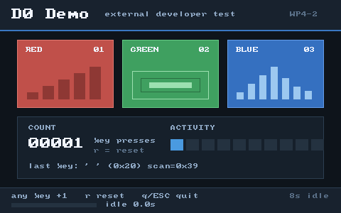

# hello_d0 —— 外部开发者写的一个 GUI 应用（E4 / WP4-2）

> 这是 **WP4-2 外部开发者测试**的产物：只读 `sdk/README.md`、
> `docs/sdk/getting-started.md`、`sdk/include/aster/**`、`docs/abi/abi-1.0-draft.md`
> 和 `docs/design/display-server-ng.md`，从零写出来的普通应用。
> **不是 `hello_gui` 的复制**：没有 demo harness 角色（`window`/`hold`），
> 没有照搬它的布局和证据行。



（`screen.png` 是 `tools/d0-demo.ps1` 的 QMP screendump 裁出的窗口：480×300，
注入一次空格后 `count=1` 的那一帧。）

## 1. 长什么样、能做什么

窗口 **480×300**，标题 **`D0 Demo`**（display v3 CREATE 的 title）：

- 标题栏：`D0 Demo` 2 倍字号 + `external developer test` + `WP4-2`；
- 3 个彩色卡片（红/绿/蓝），每张卡各带一种图形：红色递增柱状图、绿色嵌套
  画框、蓝色波形/均衡器；
- 计数器面板：`COUNT` + **5 位定宽大字**（2 倍字号）+ 10 格 `ACTIVITY`
  活动条（亮 `count % 10` 格）+ 最后按键（字符/控制键 + ASCII + scancode）；
- 页脚：`any key +1   r reset   q/ESC quit`、`8s idle` 提示，以及一个随空闲
  时间增长的进度条（每 ~0.5s 用**脏矩形**只提交页脚，不全窗重绘）。

按键行为：

| 输入 | 行为 |
|---|---|
| 任意 `KEY_DOWN`（含控制键） | `count++`，整窗重绘 + COMMIT，打印 `ng: d0 key ok (...)` |
| `r` / `R` | `count = 0`，重绘，打印 `ng: d0 reset ok (count=0)` |
| `q` / `Q` / `Esc` | 退出循环，`reason=q/esc` |
| **连续 8s 没有任何输入** | 退出循环，`reason=idle`（400 次 `ASTER_DISPLAY_POLL_TICKS` ≈ 20ms 超时） |

退出路径统一：有会话时 `EXIT`，然后 `aster_app_close()`（DESTROY + BYE +
close port），再打印 `ng: d0 demo bye (...)` 返回 0。displayd 先死（例如被
kill）时 `aster_app_poll()` 返回 `-ECANCELED`，应用打印 `reason=display`
后干净收尾，不 panic。

## 2. 目录

```text
sdk/examples/hello_d0/
├── main.c      # 全部代码（单文件，约 550 行，含注释）
├── README.md   # 本文件
└── screen.png  # QEMU 截图（tools/d0-demo.ps1 的 QMP screendump）
```

## 3. 用到了哪些公共 API

全部来自 `sdk/include/aster/`，**没有 include 任何内核/桌面头，没有 libc，
没有 FPU/SIMD**：

| 头文件 | 用到的 API | 用途 |
|---|---|---|
| `app.h` | `ASTER_APP_MAIN`、`aster_app_open/focus/poll/commit/running/quit/close` | 窗口 + 事件循环骨架、默认 `_start` |
| `session.h` | `aster_session_connect/register/heartbeat/exit/close` | 会话通道（有就注册/心跳，没有就 token=0 跑） |
| `draw.h` | `aster_surface_clear`、`aster_draw_fill/rect/char/text`、`aster_font_glyph`、`ASTER_RGB` | 绘制；2 倍字用 `aster_font_glyph` + 2×2 `fill` 自己放大 |
| `display.h` | `aster_display_commit`（脏矩形）、`ASTER_DISPLAY_POLL_TICKS`、`ASTER_EVENT_KEY_DOWN` | 局部提交 + 轮询超时 |
| `syscall.h` | `aster_puts`、`aster_console_write`、`aster_getpid` | 串口证据行（无 libc） |

编译期还会打印 `ASTER_SDK_VERSION` / `ASTER_ABI_VERSION`：
`ng: d0 boot ok (sdk=0.1.0-alpha abi=0x00010000)`。

## 4. 从零到运行

以下命令都在**仓库根目录**（`D:\OS_Project`）执行。

### 4.1 前置条件

- clang / ld.lld：`D:\msys64\mingw64\bin`（`clang --version`、`ld.lld --version`）；
- 只想编译：不需要 QEMU；
- 想在 QEMU 里真跑：QEMU（PATH 或 `D:\Program Files\qemu`）。

### 4.2 语法门禁（宿主 clang，不链接）

```powershell
clang -fsyntax-only -std=c11 -ffreestanding -fno-builtin -Wall -Wextra -Werror `
  -I sdk/include sdk/examples/hello_d0/main.c
```

`tools/sdk-check.ps1` 会**自动**把本文件纳入（它递归扫 `sdk/examples/**/*.c`）：

```text
[ ok ] sdk/examples/hello_d0/main.c
sdk-check: PASS (10 files + 237 SDK host checks)
```

### 4.3 交叉编译 + 链接成 ELF64（无 libc，入口 0x40000000）

```powershell
$out = '.obj-d0'
New-Item -ItemType Directory -Force $out | Out-Null

clang --target=x86_64-elf -ffreestanding -nostdlib -mno-red-zone `
  -fno-stack-protector -fcf-protection=none -mno-sse -mgeneral-regs-only `
  -fno-builtin -fno-pic -fno-pie -std=c11 -Os -Wall -Wextra -Werror `
  -ffunction-sections -fdata-sections -I sdk/include `
  -c sdk/examples/hello_d0/main.c -o $out/hello_d0.o

# 注意：PowerShell 会把未加引号的 -Wl,-T,... 里的逗号当数组分隔符，
# 所以链接参数要写成数组（或用引号包住每个 -Wl,... 参数）。
$largs = @(
  '--target=x86_64-elf', '-fuse-ld=lld', '-nostdlib',
  '-Wl,-T,src/ng/user/user.ld', '-Wl,--build-id=none',
  '-Wl,--fatal-warnings', '-Wl,--gc-sections',
  '-o', "$out/hello_d0.elf", "$out/hello_d0.o"
)
clang @largs
```

本机结果：

```text
hello_d0.elf: 23296 bytes, 2 PT_LOAD, entry 0x40000000, end 0x4000468e
```

（内核 `-SdkDemo` 的 `Test-NgUserElf -MinLoad 2` 要求 ≥2 个 PT_LOAD，本应用
正好 2 个：`.text` RX + `.rodata` R；没有 `.data/.bss`。整个镜像远小于
0x40010000 的 64 KiB 窗口。）

### 4.4 一条命令在 QEMU 里真跑（推荐）

```powershell
powershell -ExecutionPolicy Bypass -File tools/d0-demo.ps1
```

它做四件事：

1. 用上面的参数编译/链接 + 校验 ELF（入口、PT_LOAD、W^X）；
2. 在系统临时目录搭一个 **overlay**：`src/tests/tools/sdk/include/sdk/examples/hello_d0`
   都是指回仓库的 junction，只有 `sdk/examples/hello_gui/main.c` 是一个
   `#include "../hello_d0/main.c"` 的代理文件；然后调用仓库里**原封不动**的
   `tools/build-ng.ps1 -SdkDemo`。这样 `/bin/demo` 就是 hello_d0，而
   `build-ng.ps1`、默认构建和仓库工作区都没有被修改；
3. QEMU（stdvga + QMP）启动，等 `ng: d0 demo up (...)`，确认
   `ng: surface title ok (id=.. title=D0 Demo)`；
4. QMP 注入空格 → 断言 `ng: d0 key ok (key=0x20 count=..)`；`stop` 后
   screendump，断言窗口内 `(x+30,y+60)=#c0504a`（红卡片）、
   `(x+40,y+170)=#16202b`（面板）、`(x+460,y+30)=#18222e`（标题栏）；
   再 `cont`、注入 `q`、断言 `ng: d0 demo bye (... reason=q/esc)`。

本机输出（15.6s）：

```text
d0-demo: link ok (23296 bytes, 2 PT_LOAD, entry 0x40000000, end 0x4000468e)
d0-demo: === overlay build (build-ng -SdkDemo, repo 未修改) ===
...
build-ng: PASS -> ...\overlay\.dist-d0\aster-ng.elf
d0-demo: app up (pid=9 id=1 x=160 y=120 w=480 h=300 token=0x00000000 session=0)
d0-demo: key ok (space -> count=1)
d0-demo: screendump card=(190,180)#c0504a panel=(200,290)#16202b header=(620,150)#18222e
d0-demo: q quit ok (reason=q/esc)
d0-demo: PASS (480x300 D0 Demo, 3 cards, key+redraw, q quit; 15.6s, cpu max)
```

只做编译/链接校验、不跑 QEMU：

```powershell
powershell -ExecutionPolicy Bypass -File tools/d0-demo.ps1 -NoQemu
# d0-demo: PASS (link-only, 0.5s; QEMU skipped by -NoQemu)
```

其它参数：`-KeepTemp`（保留 overlay/串口日志/截图）、`-Cpu qemu64`、`-TimeoutSec 90`。

### 4.5 串口证据行

```text
ng: d0 boot ok (sdk=0.1.0-alpha abi=0x00010000)
ng: surface title ok (id=1 title=D0 Demo)
ng: d0 demo up (pid=9 id=1 x=160 y=120 w=480 h=300 token=0x00000000 session=0)
ng: d0 draw ok (cards=3 count=0)
ng: d0 key ok (key=0x20 count=1)
ng: d0 quit ok (reason=q/esc rounds=24 idle=0)
ng: d0 demo bye (id=1 count=1 rounds=24 reason=q/esc)
```

空闲自动退出（不注入按键时，QEMU 里实测）：

```text
ng: d0 quit ok (reason=idle rounds=400 idle=400)
ng: d0 demo bye (id=1 count=0 rounds=400 reason=idle)
```

### 4.6 部署的现实

WP4-2 的约束是「只能新增自己的应用、不改内核/桌面/构建系统」，所以
**没有**把 hello_d0 装进 `/System/Packages` 或 `/bin`：

- alpha 没有用户态安装器，`/System/Packages` 只在构建期 seed；
- `build-ng.ps1 -SdkDemo` 硬编码了 `sdk/examples/hello_gui/main.c`；
- 从内核 shell 里 `spawn /bin/hello_d0` 也需要 ELF 先进镜像（构建期
  `.incbin`），而且直连 spawn 没有 `session=`/`token=`（token=0）。

`tools/d0-demo.ps1` 的 overlay 是**测试通道**，不是产品部署机制；产品化需要
D1 的 `pkg install` 或给 build-ng 加一个「demo 源文件」参数（都不是本 WP
能改的路径）。

## 5. 代码结构（main.c）

| 函数 | 作用 |
|---|---|
| `d0_put*` / `d0_sput/shex` / `d0_fmt_count` | 无 libc 的串口输出 / 字符串拼装 / 5 位定宽十进制 |
| `d0_text2x` | 用 `aster_font_glyph` + 2×2 `aster_draw_fill` 放大 8×8 字模（SDK 没有缩放 API） |
| `d0_draw_header/cards/panel/footer/draw_all` | 全部绘制；坐标是 480×300 的常量布局 |
| `ASTER_APP_MAIN` | session → open → focus → 首帧 → 循环 → 收尾 |

事件循环（`main.c` 底部）：

```c
while (aster_app_running(&app)) {
    rc = aster_app_poll(&app, &ev, ASTER_DISPLAY_POLL_TICKS);
    if (rc < 0) { reason = "display"; break; }
    rounds++;
    if (rc == 0) {
        idle++;
        if (idle >= D0_IDLE_LIMIT) { reason = "idle"; break; }
        if ((rounds % 25u) == 0u) { /* 只重绘/提交页脚脏矩形 */ }
    } else if (ev.type == ASTER_EVENT_KEY_DOWN && ...) {
        idle = 0;
        /* q/ESC 退出；r 归零；其它 count++ → 重绘 + commit */
    }
    if (have_session && (rounds % ASTER_SESSION_HEARTBEAT_ROUNDS) == 0u) {
        (void)aster_session_heartbeat(&sess, rounds);
    }
}
```

## 6. 实际遇到的问题（按卡住的程度）

| # | 现象 | 原因 | 解决 | 属于 |
|---|---|---|---|---|
| 1 | `sdk-check` 报 `-Wcomment` | 自己的注释里写了 `<aster/*.h>`，`/*` 嵌套 | 改写注释（`sdk-check` 对 examples 也开 `-Werror`） | 工具链 |
| 2 | `-Wunused-function` | 先写了定宽十进制 helper，最后没用上 | 删掉或真正使用 | 工具链 |
| 3 | PowerShell 报 `缺少参数` | `-Wl,-T,src/...` 未加引号时逗号被当数组分隔符 | 用 `@(...)` 数组传参（README/脚本都按这个写） | 工具链 |
| 4 | 只能等 20ms 轮询 | SDK/内核没有 `sleep/timer` API | 用 `aster_app_poll` 超时累计 idle，400 次≈8s | **SDK 缺口** |
| 5 | 写证据行很啰嗦 | 没有 `snprintf`/格式化 | 自己写 `d0_put_u32/hex`、`d0_sput/shex` | **SDK 缺口** |
| 6 | 字号只有 8×8 | `aster_draw_text` 不支持缩放 | 用公共 `aster_font_glyph` 自己 2×2 放大 | **SDK 缺口** |
| 7 | `token=0x0x...` | 两次加 `0x`（`d0_put("0x")` + `hex8` 自己也加） | 串口日志抓出来的；语法检查/宿主测试都发现不了 | 自己的 bug（QEMU 才发现） |
| 8 | 按键要过滤 | `aster_app_poll` 对 KEY_DOWN/KEY_UP 都返回 1 | 只处理 `ASTER_EVENT_KEY_DOWN`；`ev.surface_id` 校验归属 | 文档够用（getting-started §2） |
| 9 | `sdk-check` 过了但链接/运行可能错 | `sdk-check` 只做宿主 `-fsyntax-only` + 纯函数测试，不做 `x86_64-elf` 链接 | 额外跑 4.3 的链接步骤 / `tools/d0-demo.ps1 -NoQemu` | **SDK 门禁缺口** |
| 10 | 自己的应用没法 `-SdkDemo` | `build-ng.ps1 -SdkDemo` 硬编码 `hello_gui` | overlay + 三行代理文件（不改 build-ng） | **构建/部署缺口** |
| 11 | 真跑时 WP3-1/3-2/3-3 selftest FAIL | 本应用占用了 `/bin/demo` 的位置，但不像 hello_gui 那样实现 `window`/`hold` 角色，也不画 displayd 的 `(25,25)=#3070c0` 探针 | 不修应用（普通应用不该背 demo harness）；脚本只断言应用自身行为与像素 | **部署/文档缺口** |
| 12 | 没法验证会话注册 | 只有 WM 的 `LAUNCH` 才会给 `session=`/`token=`；本应用经内核自检直接 spawn（token=0） | 代码路径保留并编译；真验证需要安装器/产品启动链 | **SDK 缺口** |
| 13 | 窗口标题超过 15 字符会被截断 | `ASTER_DISPLAY_TITLE_MAX=16`，文档只在 README 提了「15 字符 + NUL」 | 本应用用 7 字符；自检里加长度断言更稳 | 文档够用，但易踩 |
| 14 | 每次脏矩形提交 displayd 都打一行 `composite ok` | displayd 的诊断输出 | 无害；页脚 17 行日志 | 工具噪音 |
| 15 | `aster_display_destroy` 发完就走 | 无 reply 语义 | 只能保证「不阻塞」；无法确认服务端已回收 | **SDK 缺口** |

## 7. SDK 还缺什么（给 D1 的输入，本 WP 只记录、不改 SDK）

按对「外部开发者一天内写出可用 GUI app」的影响排序：

1. **部署/启动通道（P0）**：没有 `pkg install`，`/System/Packages` 只构建期
   seed；`-SdkDemo` 只认 hello_gui。外部开发者的应用没有一条不改仓库就能
   进镜像、被 sessiond 拉起的路。建议：`build-ng -DemoSrc <path>` 或最小
   `pkg install`（staging 树 + sha256 校验），并让 sessiond 的 LAUNCH 能按
   包名启动。
2. **可移植的构建门禁（P0）**：`sdk-check` 只做宿主 `-fsyntax-only`，不链接
   `x86_64-elf`，抓不到 `_start`/重定位/段布局问题。建议加一个 `-NoQemu`
   的 freestanding link + ELF 校验步骤。
3. **格式化/字符串（P1）**：没有 `snprintf` 等价物，写状态行/数字要自己造
   3 个 helper。建议 `aster_text` 小模块（dec/hex/pad）。
4. **文字排版（P1）**：只有 8×8 单行，没有缩放/换行/裁剪/宽度查询。
5. **时间（P1）**：没有 `sleep/timer/uptime`，做动画/超时/倒计时只能数
   poll 超时；`ASTER_DISPLAY_POLL_TICKS` 的 20ms 只是 TSC tick 近似。
6. **图形（P2）**：只有 pixel/fill/rect/char/text；没有 line/circle/
   rounded-rect、没有 alpha 混合/裁剪 API 之外的形状。
7. **生命周期可观测性（P2）**：DESTROY 无回复；`shm` 无 free；窗口关闭/
   失焦没有事件。
8. **输入（P2）**：没有鼠标、没有按键重复/修饰键状态（只有 scancode）、
   没有焦点变化事件。
9. **ABI 稳定性（P0/文档）**：ABI 1.0 未冻结；没有 `abi_version()` 调用，
   应用只能按头文件版本假设（本应用把 `ASTER_SDK_VERSION`/`ASTER_ABI_VERSION`
   打进 boot 行，方便日后对账）。

文档侧的最小缺口（详见 `docs/claims/ng-WP4-2.md`）：

- `sdk/README.md` 的目录树/API 表只列 `hello_gui`，没有「普通应用 vs
  demo harness 角色」的说明；外部开发者第一次会以为 `/bin/demo` 就是普通
  应用；
- `docs/sdk/getting-started.md` 第 4 节把部署的三种现实讲清楚了，但没有给
  「外部开发者不改仓库怎么真跑」的路径（本 README 的 overlay 只能算
  workaround）；
- 没有任何文档说明 `sdk-check` 是宿主语法门禁、不覆盖链接/运行；
- ABI 草案的 §10 已列 13 个缺口，但 SDK 文档没有把「哪些缺口会影响 GUI
  应用」挑出来。

## 8. 验证记录（2026-10-31，ng @ `9a6ab48`）

```text
# 1) 语法
clang -fsyntax-only -std=c11 -ffreestanding -fno-builtin -Wall -Wextra -Werror -I sdk/include sdk/examples/hello_d0/main.c
-> exit 0

# 2) SDK 门禁（自动含本文件）
tools/sdk-check.ps1
-> sdk-check: PASS (10 files + 237 SDK host checks)

# 3) freestanding 链接
-> hello_d0.elf: 23296 bytes, 2 PT_LOAD, entry 0x40000000, end 0x4000468e

# 4) QEMU 真跑（-SdkDemo 通道，不改 build-ng）
tools/d0-demo.ps1
-> PASS (480x300 D0 Demo, 3 cards, key+redraw, q quit; 15.6s, cpu max)
```

注意：QEMU 日志里的 `ng: WP3-1 display status FAIL` / `WP3-2/3-3 selftest
skipped` 是**预期**的——本应用不是 hello_gui 的 demo harness，占用了
`/bin/demo` 但故意不实现 `window`/`hold` 角色；`tools/d0-demo.ps1` 因此只
断言 hello_d0 自己的证据行与像素，不把内核 selftest 当作本应用的验收项。
